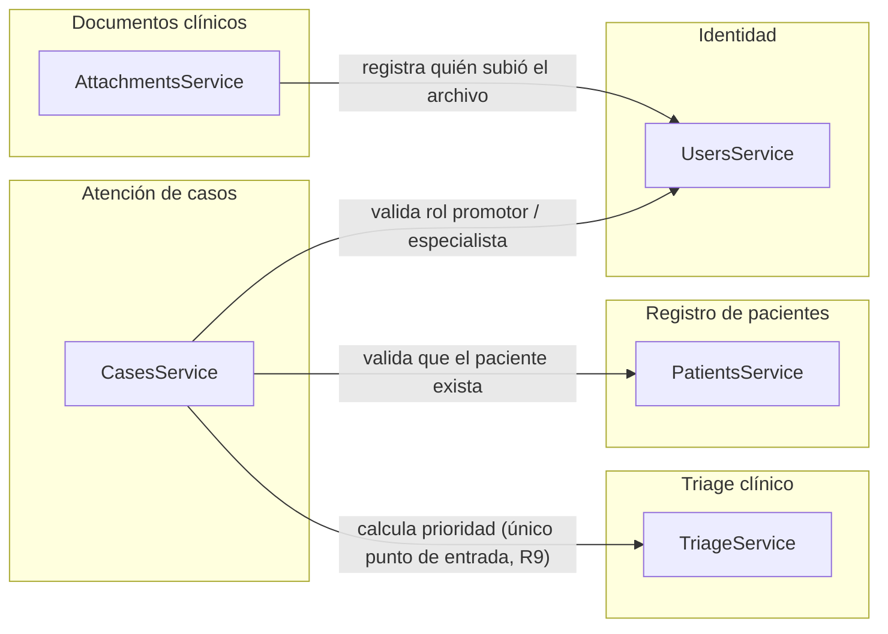
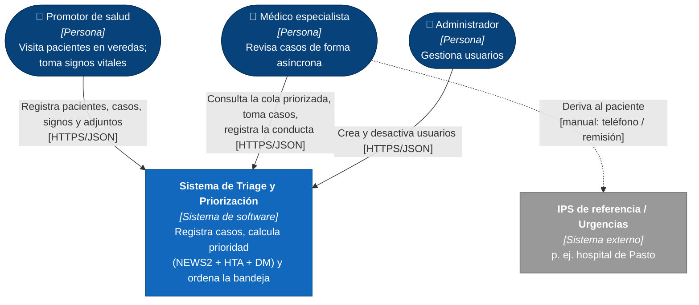
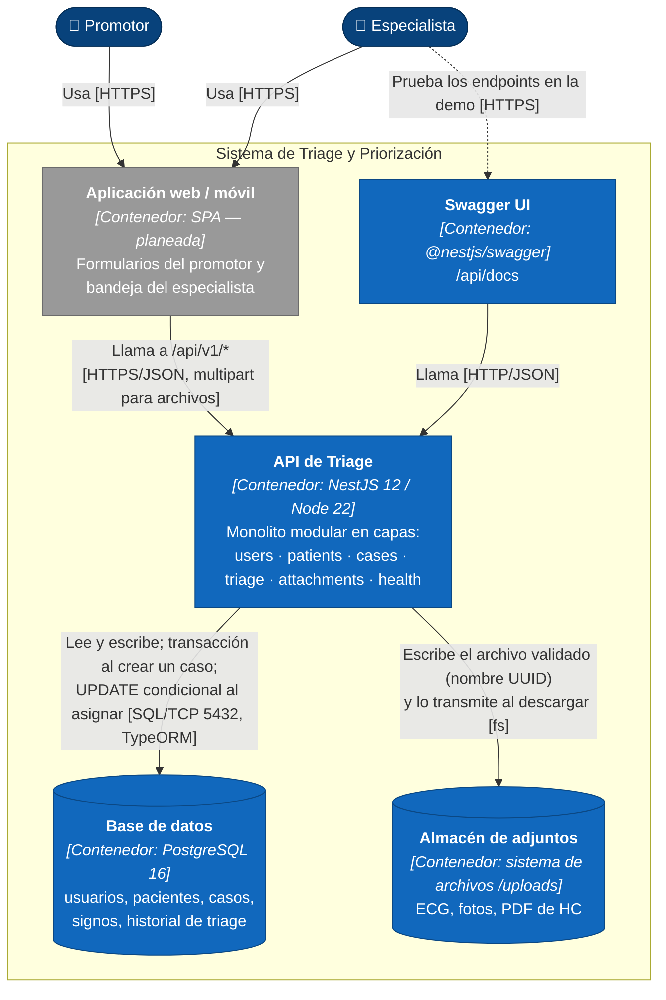

# Diseño documentado — API de Triage y Priorización de Casos Clínicos

**Arquitectura de Software · Proyecto integrador · UCC Pasto · Momento evaluativo 3**
Integrantes: _________________________ · _________________________ · _________________________

| Pieza del Entregable 1 | Sección |
|---|---|
| Drivers priorizados (árbol de utilidad + restricciones) | [§2](#2-drivers-priorizados) |
| Escenarios completos | [§3](#3-escenarios-de-calidad) |
| Estilo elegido, por qué driver y qué sacrifica | [§4](#4-estilo-arquitectónico) |
| Contextos delimitados | [§5](#5-contextos-delimitados) |
| Tácticas aplicadas | [§6](#6-tácticas-aplicadas) |
| Diagramas C4 nivel 1 y 2 | [§7](#7-diagramas-c4) |
| Tres ADR | [adr/](adr/) |
| Riesgos identificados | [§8](#8-riesgos-identificados) |
| Cómo responde el diseño a las 4 preguntas de la sustentación | [DEFENSA.md](DEFENSA.md) |

Todas las medidas citadas como "medido" salen del esqueleto real (`npm run test:todo` → [evidencias/REPORTE.md](../evidencias/REPORTE.md)).

---

## 1. Dominio

En la zona rural de Pasto (Nariño) un **promotor de salud** visita a los pacientes, sobre todo hipertensos y diabéticos.
Toma signos vitales y síntomas, y registra el caso. Un **médico especialista** urbano revisa los casos **de forma asíncrona**
(telexperticia) y puede recibir decenas al día. El sistema calcula un **puntaje de riesgo** con cada caso para ordenar la
bandeja del médico: así lo urgente se ve primero.

**Por qué no es un CRUD:**

| Fuente de complejidad | Concretamente |
|---|---|
| Reglas de negocio no triviales | NEWS2 (7 parámetros, 2 escalas de SpO₂), clasificación de HTA (ESH 2023), umbrales de glucemia (ADA), detección de síntomas de alarma en texto libre con negación, y "la prioridad final es la más grave". Máquina de estados del caso con transiciones prohibidas |
| Varios tipos de usuario | **Promotor** (registra en campo y necesita la prioridad al instante), **Especialista** (consume una cola compartida y toma casos), **Administrador** (gestiona usuarios) |
| Restricciones externas | Normativa colombiana de telesalud y de datos de salud, la escala clínica NEWS2 como estándar externo y la conectividad rural (ver §2.3) |

---

## 2. Drivers priorizados

### 2.1 Drivers de negocio → atributos de calidad

| # | Driver de negocio | Atributo de calidad |
|---|---|---|
| D1 | Un caso grave **no puede quedar enterrado** en la bandeja: el error más caro es clasificar ALTA como BAJA | **Corrección / seguridad clínica** |
| D2 | Varios especialistas comparten **una** cola: un caso no puede quedar atendido por dos médicos ni por ninguno | **Integridad ante concurrencia** |
| D3 | El médico asesor **todavía debe validar** los umbrales: las reglas van a cambiar | **Modificabilidad de las reglas clínicas** |
| D4 | El especialista abre la bandeja muchas veces al día | **Rendimiento** de la cola |
| D5 | Datos sensibles de salud (historia clínica, adjuntos) | **Seguridad / privacidad** |
| D6 | Si algo falla en la BD, el promotor en campo no debe quedar sin nada | **Disponibilidad** |

### 2.2 Árbol de utilidad

Importancia para el negocio / dificultad técnica: **A** = alta, **M** = media, **B** = baja.
Las hojas **(A, A)** y **(A, M)** son las que guían la arquitectura.

```
Utilidad
├── Corrección clínica (D1)
│   ├── E1  Un caso con PA ≥180/110 + cefalea intensa queda ALTA y primero en la cola ......... (A, M) ★
│   └── E1b Toda regla clínica tiene prueba automática con su valor de frontera ................ (A, B)
├── Integridad ante concurrencia (D2)
│   └── E2  Dos especialistas toman el mismo caso a la vez → exactamente uno lo obtiene ......... (A, M) ★
├── Modificabilidad (D3)
│   ├── E3  Cambiar un umbral clínico toca un solo archivo y no rompe nada más ................. (A, B) ★
│   └── E3b Cambiar umbrales sin redesplegar (reglas en BD/configuración) ..................... (B, A)
├── Rendimiento (D4)
│   ├── E4  Cola con 100 casos abiertos: p99 < 500 ms ......................................... (M, B)
│   └── E4b Cola con 1000 casos abiertos (10x): p99 < 500 ms ................................. (M, A)
├── Disponibilidad (D6)
│   └── E5  Cae PostgreSQL → la API no se cae, lo detecta y se recupera sola .................. (M, M)
├── Seguridad / privacidad (D5)
│   ├── E6  Un adjunto con tipo no permitido no llega al disco ............................... (A, B)
│   └── E6b Solo el usuario autenticado con el rol correcto ve o toma un caso ................ (A, A) ⚠ no resuelto en el esqueleto (riesgo R3)
└── Operación en campo
    └── E7  El promotor registra sin conexión y sincroniza después ........................... (M, A) fuera de alcance
```

**Cómo se usó la priorización:**

- Las hojas ★ (E1, E2, E3) **definieron el estilo y las tácticas**.
- E4b y E3b se aceptaron como **deuda consciente**. Son justo lo que se rompe al crecer 10 veces (ver [DEFENSA.md](DEFENSA.md)).
- E6b y E7 se reconocen como no resueltas. Aparecen como riesgos y no se esconden.

### 2.3 Restricciones

| Restricción | Tipo | Efecto en el diseño |
|---|---|---|
| **Resolución 2654 de 2019** (MinSalud, telesalud): en la telexperticia la decisión clínica es del profesional | Normativa | El sistema **sugiere** una prioridad y nunca decide. El especialista registra la conducta (`specialistNotes` es obligatorio al atender o derivar) |
| **Ley 1581 de 2012** (datos personales, los de salud son sensibles) | Normativa | Lista blanca de tipos de archivo y nombres en disco no adivinables (UUID). La falta de autenticación queda como riesgo R3 |
| **Resolución 1995 de 1999** (historia clínica: integridad y conservación) | Normativa | El historial de triage es **inmutable**: cada evaluación es un registro nuevo y los casos no se borran |
| **NEWS2** (Royal College of Physicians, 2017) como estándar clínico externo | Estándar externo | Las tablas de puntaje se implementan tal cual, con pruebas en los valores de frontera |
| Conectividad intermitente en veredas de Nariño | Condición de operación | El cálculo de triage no depende de la BD (`POST /triage/evaluate` responde aunque la BD esté caída, **medido**). El modo sin conexión queda fuera de alcance |
| NestJS + TypeScript (materia), PostgreSQL, 3 integrantes, 3 semanas | Técnica / organizacional | Inclina hacia **un solo despliegue** (ver ADR-001) |

---

## 3. Escenarios de calidad

Formato de 6 partes: fuente · estímulo · artefacto · entorno · respuesta · **medida**.

### E1 — Corrección clínica (A, M)

| Parte | Valor |
|---|---|
| Fuente | Promotor en campo |
| Estímulo | Registra un caso: PA 192/112, glucosa 210 y el síntoma "dolor de cabeza intenso y visión borrosa. Niega dolor de pecho" |
| Artefacto | `CasesService` → `TriageService` |
| Entorno | Operación normal |
| Respuesta | El caso se guarda con prioridad **ALTA** (alerta `HTA_EMERGENCIA`), sin falsa alerta de dolor torácico, y queda **primero** en la cola |
| Medida | 100 % de la batería de casos de frontera da la prioridad esperada (12 unitarias + 28 e2e **pasan**). La respuesta llega en la misma petición: p99 de `POST /cases` = **231 ms** con 10 promotores (**medido**) |

### E2 — Integridad ante concurrencia (A, M)

| Parte | Valor |
|---|---|
| Fuente | Dos especialistas |
| Estímulo | Hacen `PATCH /cases/:id/assign` sobre el mismo caso **al mismo tiempo** |
| Artefacto | `CasesService.assignCase` + PostgreSQL |
| Entorno | Operación normal, peticiones en paralelo |
| Respuesta | Uno recibe 200 y el caso pasa a EN_REVISION a su nombre. El otro recibe **409** |
| Medida | **0 dobles asignaciones** en 10 de 10 intentos paralelos (prueba e2e §10). Con la versión anterior del código la misma prueba daba `[200, 200]`: era una doble asignación real, detectada y corregida |

### E3 — Modificabilidad de reglas clínicas (A, B)

| Parte | Valor |
|---|---|
| Fuente | Médico asesor del proyecto |
| Estímulo | Pide cambiar el umbral de crisis hipertensiva de PAD ≥110 a PAD ≥120 (criterio ACC/AHA) |
| Artefacto | Reglas clínicas |
| Entorno | Desarrollo |
| Respuesta | El cambio se hace en `applyHypertensionRules`, se ajusta su prueba y se redespliega |
| Medida | **1 archivo de producción** modificado (`triage.service.ts`). Ningún controller, entidad ni otro módulo cambia (lo garantizan R9 y R10 de la prueba de arquitectura). Menos de 1 hora, incluidas las pruebas |

### E4 — Rendimiento de la cola (M, B)

| Parte | Valor |
|---|---|
| Fuente | 10 especialistas |
| Estímulo | Consultan `GET /triage/queue` de forma continua |
| Artefacto | `TriageService.getPrioritizedQueue` + PostgreSQL |
| Entorno | Carga normal: 100 casos abiertos |
| Respuesta | La cola sale ordenada ALTA → MEDIA → BAJA, luego por NEWS2 y luego por tiempo de espera |
| Medida | p99 < 500 ms. **Medido: 177 ms**, 0 errores. Con 10x (1000 casos) el p99 es **1789 ms**: no se cumple, ver R2 |

### E5 — Disponibilidad (M, M)

| Parte | Valor |
|---|---|
| Fuente | Falla de infraestructura |
| Estímulo | PostgreSQL se detiene |
| Artefacto | API completa |
| Entorno | Operación normal con casos registrados |
| Respuesta | La API **no se cae**: `/health` pasa a 503 y el cálculo de triage sigue respondiendo. Lo que necesita BD falla con el error estándar. Al volver la BD, se recupera sin reiniciar y sin perder datos |
| Medida | Detección en **15 ms**, recuperación en **607 ms** desde `docker start` y **0 datos perdidos** (**medido**, 8/8 verificaciones) |

### E6 — Privacidad de adjuntos (A, B)

| Parte | Valor |
|---|---|
| Fuente | Usuario (por error o malicia) |
| Estímulo | Sube un `.txt` o `.exe` como "ECG" |
| Artefacto | `AttachmentsModule` (Multer) |
| Entorno | Operación normal |
| Respuesta | 400. El archivo **no** se escribe en disco |
| Medida | 100 % de los tipos fuera de la lista blanca (JPG/PNG/WEBP/PDF) se rechazan y 0 archivos huérfanos (e2e §9) |

---

## 4. Estilo arquitectónico

### Elegido: **monolito modular en capas** (un proceso, módulos por contexto y capas dentro de cada módulo)

```
          HTTP
           │
   ┌───────▼────────┐   Controller: solo traduce HTTP ↔ DTO
   │  Presentación  │   (no conoce la BD ni services de otros módulos)
   ├────────────────┤
   │   Aplicación   │   Service: reglas de negocio, transacciones
   │   / Dominio    │   (TriageService = reglas clínicas puras)
   ├────────────────┤
   │  Persistencia  │   Entity + Repository (TypeORM)
   └───────┬────────┘
           ▼
       PostgreSQL
```

La dependencia **solo apunta hacia abajo**, y se **verifica automáticamente** en cada ejecución de `npm run test:arq`
(reglas R1–R10 en [test/arquitectura/arquitectura.spec.ts](../test/arquitectura/arquitectura.spec.ts)). Por ejemplo: un
controller que importe una entidad o TypeORM hace fallar la prueba y la prueba dice en qué archivo.

### Por qué driver

| Driver | Cómo lo sirve el estilo |
|---|---|
| **E1 Corrección (A,M)** | Caso + signos + triage se guardan en **una transacción local** de PostgreSQL. No hay ninguna ventana en que el caso exista sin prioridad (ADR-002). Las reglas están en una capa sin HTTP ni BD, así que se prueban de forma unitaria |
| **E2 Concurrencia (A,M)** | Una sola BD relacional permite un `UPDATE ... WHERE assigned_to IS NULL` atómico, sin coordinación distribuida |
| **E3 Modificabilidad (A,B)** | Las reglas viven en un único módulo con un único punto de entrada (R9/R10 verificadas) |
| **Restricción: 3 personas, 3 semanas** | Un solo despliegue y un solo comando para arrancar (`npm run levantar`) |

### Qué sacrifica (y por qué es aceptable)

| Sacrificio | Evidencia | Por qué es aceptable hoy |
|---|---|---|
| **Escalabilidad independiente**: no se puede escalar solo la cola | Con 10x casos la cola pasa de p99 177 ms a **1789 ms** (10 veces más lenta) mientras la evaluación apenas cambia | Hoy hay decenas de casos al día. La primera mitigación (paginación + índice) no requiere cambiar de estilo |
| **Aislamiento de fallos**: un error grave tumba todo el proceso | Un solo proceso Node | Se mitiga con el filtro global de excepciones y la degradación parcial (E5, medido) |
| **Despliegue independiente**: cambiar una regla clínica redespliega toda la API | — | El volumen de cambios es bajo y el redespliegue toma minutos |

### Alternativas descartadas

| Alternativa | Por qué se descartó |
|---|---|
| **Microservicios** (Casos, Triage y Pacientes como servicios separados) | Rompe E1: crear el caso y su triage pasaría a ser una transacción **distribuida** (saga o consistencia eventual). E2 necesitaría bloqueo distribuido. Además, el costo operativo (varios procesos, red, observabilidad) no lo justifica ningún driver (A,·) y no hay equipos independientes que lo pidan |
| **Arquitectura dirigida por eventos** (`CasoRegistrado` → el triage consume después) | Rompe E1 de otra forma: el promotor en campo necesita **ver la prioridad en la respuesta** para decidir si remite ya. Además, un caso podría aparecer en la cola sin prioridad durante la ventana de consistencia eventual |
| **Hexagonal / Clean "pura"** (puertos y adaptadores, dominio sin TypeORM) | Mejoraría la independencia del dominio frente a la BD, pero ningún driver la exige y duplica modelos (entidad de dominio + entidad ORM). Se tomó una parte: el cálculo clínico (`calculateRisk`) no usa BD ni HTTP |

Detalle completo en [ADR-001](adr/ADR-001-monolito-modular-en-capas.md).

---

## 5. Contextos delimitados

| Contexto | Módulo | Lenguaje propio | Señal que justifica la frontera |
|---|---|---|---|
| **Triage clínico** | `triage/` | NEWS2, parámetro en rojo, escala 1/2, alerta, prioridad sugerida | **Ritmo de cambio y dueño distintos**: cambia cuando el médico asesor valida umbrales, no cuando cambia el flujo de atención. Es el único contexto con reglas basadas en estándares clínicos externos |
| **Atención de casos** | `cases/` | Caso, toma de signos, asignar, liberar, estado, derivar | **Ciclo de vida propio** (máquina de estados) y **concurrencia** (cola compartida). Orquesta a los demás: es el único que llama a Triage (R9) |
| **Registro de pacientes** | `patients/` | Paciente, documento, antecedentes, vereda | **Vida más larga que un caso**: un paciente tiene muchos casos durante años. Su invariante (documento único por tipo) no tiene nada que ver con la atención |
| **Documentos clínicos** | `attachments/` | Adjunto, ECG, tipo MIME, custodia | **Regulación distinta** (custodia de historia clínica, Res. 1995/1999) y **almacenamiento distinto** (disco, no filas) |
| **Identidad** | `users/` | Usuario, rol, especialidad, activo | **Consumido por todos con poco detalle**. Es el candidato natural a reemplazarse por un proveedor de identidad (JWT/OIDC) sin tocar el resto |
| *Soporte:* Salud del sistema | `health/` | Estado, BD arriba | Técnico, sin lenguaje de negocio |

**Fronteras que hoy no son perfectas:** las entidades se referencian entre contextos porque comparten una sola BD
(por ejemplo, `TriageRecord → Case`). La prueba de arquitectura lo hace visible (mapa de dependencias en el reporte) y lo
limita: entre contextos solo se cruzan **entidades** y services declarados, nunca controllers. Separar las bases de datos
sería el primer paso si algún contexto se convirtiera en servicio aparte.



---

## 6. Tácticas aplicadas

| # | Táctica | Contra qué escenario | Dónde está | Qué degrada |
|---|---|---|---|---|
| T1 | **Transacción local** (todo o nada) al crear un caso | E1 | `CasesService.createCase` (`dataSource.transaction`) | Latencia: mantiene la conexión durante 3 escrituras. Acoplamiento: Triage recibe el `EntityManager` de quien lo llama |
| T2 | **Actualización condicional atómica** (control de concurrencia optimista) | E2 | `assignCase`: `UPDATE ... WHERE status='PENDIENTE' AND assigned_to IS NULL` | Usabilidad: el segundo especialista recibe un 409 y debe elegir otro caso |
| T3 | **Validación en el borde** (DTO + rangos fisiológicos + `whitelist`) | E1, E6 | `ValidationPipe` global, `vital-signs.dto.ts` | Flexibilidad: un valor extremo pero real fuera de rango (por ejemplo, glucosa >1500) se rechaza en lugar de registrarse |
| T4 | **Encapsular y aislar las reglas** (un único punto de entrada, sin dependencias) | E3, E1 | `TriageService` + reglas R9/R10 | Cohesión del archivo: `TriageService` crece con cada regla. Cambiar un umbral exige redesplegar (E3b no se cumple) |
| T5 | **Desnormalizar** la prioridad, NEWS2 y alertas en `Case` | E4 | `Case.priority`, `news2Score`, `alerts` | Consistencia: hay dos copias (el caso y el historial). Cada evaluación hace 2 escrituras |
| T6 | **Detección de fallos** (health check) **+ degradación parcial** | E5 | `/health`, `POST /triage/evaluate` sin BD | Costo: cada `/health` consulta la BD. En modo simulación la evaluación no se guarda |
| T7 | **Lista blanca + límite de tamaño + escritura diferida** de adjuntos | E6 | `MulterModule` (en memoria), `AttachmentsService` | Memoria: un archivo de hasta 10 MB vive en RAM mientras se valida. No se aceptan DICOM ni otros formatos clínicos |
| T8 | **Historial inmutable** (cada evaluación es un registro nuevo) | Restricción Res. 1995/1999, E1 | `TriageRecord` | Almacenamiento creciente |

---

## 7. Diagramas C4

### Leyenda (aplica a los dos niveles)

| Elemento | Significado |
|---|---|
| Caja azul oscuro redondeada | Persona (usuario) |
| Caja azul | El sistema / contenedor que construimos |
| Caja gris | Sistema o contenedor externo, o planeado y fuera del esqueleto |
| Cilindro | Almacén de datos |
| Flecha continua | Interacción síncrona. La etiqueta dice **qué** se hace y **con qué protocolo** |
| Flecha punteada | Interacción manual o fuera del sistema |

### Nivel 1 — Contexto del sistema



### Nivel 2 — Contenedores



**Correspondencia con el esqueleto:** `npm run levantar` arranca **API + PostgreSQL**. `npm run levantar:docker` hace lo
mismo, pero con la API también en un contenedor. Los dos procesos del diagrama nivel 2 son los mismos que se ven en
`docker compose ps`. La SPA está marcada como planeada: el esqueleto se demuestra con Swagger.

---

## 8. Riesgos identificados

| # | Riesgo | Impacto | Qué habría que verificar para descartarlo | Estado |
|---|---|---|---|---|
| R1 | **Doble asignación** de un caso por condición de carrera | Dos médicos atienden al mismo paciente u otro caso queda sin atender (D2) | Prueba e2e con asignaciones en paralelo | **Confirmado y mitigado**: la prueba falló con el código original (`[200, 200]`) y pasa con T2 |
| R2 | **La cola no escala**: sin paginación ni índice, y la respuesta crece linealmente | A 10x casos el p99 sube a **1789 ms** y la respuesta pesa **1,2 MB** (medido) | Repetir `npm run test:carga` con paginación (`?limit=50`) y un índice en `(status, priority, news2_score, created_at)`, y comprobar p99 < 500 ms con 1000 casos | Abierto. Es lo **primero que se rompe** al crecer 10 veces |
| R3 | **Sin autenticación**: el `specialistId` / `createdById` viaja en el body y se puede suplantar | Violación de la Ley 1581 y acciones a nombre de otro | Prueba de seguridad: tomar un caso a nombre de otro especialista debe dar 401/403. Hoy da 200 | Abierto. Mitigación planeada: JWT + `RolesGuard`, tomando el usuario del token |
| R4 | **Falsos negativos** en la detección de síntomas por palabras clave (regionalismos como "me da el ahogo", negaciones complejas, errores de ortografía) | Un síntoma de alarma no sube la prioridad (D1) | Corpus de ≥100 notas reales anonimizadas, etiquetadas por el médico asesor. Medir la sensibilidad de la detección (meta ≥ 95 %) | Abierto. Atenuado: NEWS2 y las reglas numéricas no dependen del texto |
| R5 | **`synchronize: true`** puede borrar columnas al renombrar un campo | Pérdida de datos clínicos | Cambiar a migraciones de TypeORM y probar renombrar una columna con datos | Aceptado solo en desarrollo |
| R6 | **Umbrales no validados** clínicamente para la población local | Prioridades mal calibradas | Revisión formal del médico asesor sobre las tablas de [README §5](../README.md) | Pendiente de reunión |
